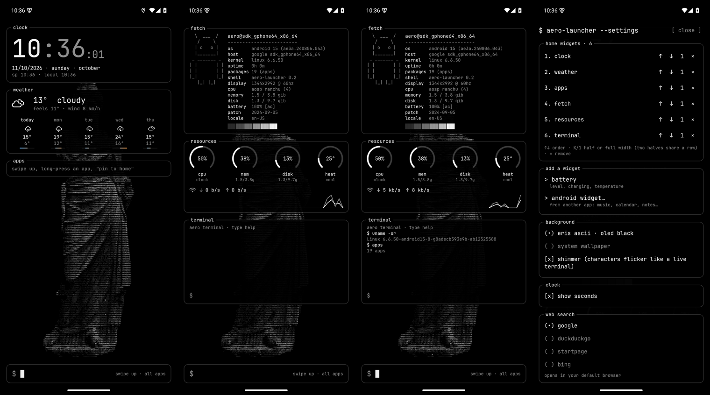

# Aero Launcher

A terminal-style Android home screen: monochrome, monospace, thin outlined boxes with the label on
the border, OLED black, and an ASCII statue drawn by the launcher itself. It mirrors the look and
the widgets of the *Arch Aero OS* desktop (Hyprland) it was made alongside.



**[Download the APK](../../releases/latest)** (Android 8+, made for a Pixel 10 Pro XL).

## Features
- **Widgets**, chosen in the launcher's own settings (order, half/full width):
  - `clock`: hours bright, minutes dim, seconds, numeric date, São Paulo and local time
  - `weather`: now + 5 days with a temperature-range bar (Open-Meteo, location from the IP); a tap opens
    the phone's weather app, whichever it is (else the forecast in the browser)
  - `apps`: pinned apps · `battery`: level, temperature, charger
  - `resources`: rings for cpu clock, memory, storage, heat + live network curve
  - `fetch`: fastfetch of the phone, read live from Android; its logo can be any picture, turned into ASCII on
    the phone and sized as a share of the widget (the text keeps its size)
  - `terminal`: launcher commands (`open`, `web`, `fetch`, `apps`, `clear`) + Android's shell (toybox, inside the app sandbox)
  - **any Android app widget** (music, calendar, notes…), hosted inside a box
- **Background**: the ASCII statue on true black (pixels off on OLED), with an optional subtle
  "live terminal" shimmer, or the system wallpaper.
- **Home grid** like Android's own launchers: workspaces side by side (create and delete them, empty
  ones too), 3–6 columns, rows automatic or chosen. Long press anything and drag it: an outline shows
  the cells where it will land and it snaps there ("magnet"); hold it at the side edge to change
  workspace; drop it on *remove* / *app info* / *uninstall*. Long press a widget and let go: handles on
  its edges, drag them to resize cell by cell. Long press an app in the list and drag it onto the home.
- **Frosted glass**: boxes and panels show the background blurred behind a see-through fill
  (opacity adjustable), like the desktop's carbon windows.
- **Settings**: theme, language, opacity, blur, font, text size, icon size, grid, `$` bar on/off.
- **Black-and-white icons, automatically** (also for apps installed later): apps with an Android 13+
  monochrome icon get it on a round plate; the others are desaturated (and inverted when too bright
  for the dark theme).
- **Gestures**: drag down = notifications, drag up = app list.
- **Search**: live filter (`ffx` finds Firefox), Enter opens the first match, `web <text>` or no
  match = your default browser with the engine you pick (Google, DuckDuckGo, Startpage, Bing).
- Long press an app: pin to home, app info, uninstall.
- **Theme**: follow the phone, dark (OLED black) or light. **Language**: English or Portuguese (pt-BR).
- Asks to become the default home screen (Android's own dialog); works with gesture navigation.
- **Lock screen** (optional, in the settings): a terminal screen over Android's own lock screen — clock,
  date · weather · next alarm, *now playing* from any app (cover in ASCII, progress, controls), battery and
  how many notifications each app has (never their text). Swipe up or tap `$ unlock`: Android still does the
  unlocking (PIN, fingerprint, Extend Unlock), and the way out is a glitch that collapses like a CRT. It needs
  "display over other apps" and, for the media, notification access; a quiet notification keeps it running.
- The home keeps its layout: places change only when you move, resize, add or remove something, not when
  the screen measures smaller for a moment (an Android update, the home animation); an app's icon leaves
  only when the app is uninstalled.

## Settings
Long press on an empty part of the home screen → `launcher settings`.

## Build
Kotlin + Jetpack Compose, no other libraries.
```
./gradlew :app:assembleRelease          # needs JDK 17 and the Android SDK (platform 35)
```
The release APK is signed with the builder's debug key: updates must come from the same machine.

## Notes
- The ASCII art is generated from a photo by `tools/ascii_grid.py`
  (`python3 tools/ascii_grid.py photo.jpg app/src/main/assets/eris.txt 100`).
- Techniques for the notification shade and the app list were studied in
  [Kvaesitso](https://github.com/MM2-0/Kvaesitso) (GPL-3.0); no code was copied.
- Font: JetBrains Mono NL Nerd Font, SIL Open Font License (`licenses/JetBrainsMono-OFL.txt`).

## License
MIT, see `LICENSE`.
